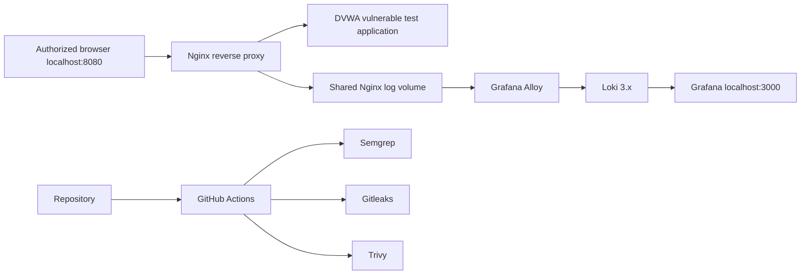

# SecureLab — Isolated Web Security & SOC Observability Lab

**SecureLab** is a containerized educational laboratory for studying the link between application events, centralized logs, SOC investigations and secure CI/CD controls.

> **Safety:** this lab includes **DVWA, an intentionally vulnerable application**. The supported Docker Compose configuration binds its published interfaces to **127.0.0.1 only** and does not expose DVWA directly. Use it on a dedicated development machine or isolated VM; never publish ports to the Internet. A configuration review is not proof of a successfully tested deployment.

## 1. Scope and architecture



The app-side Docker network is **internal**. Loki/Alloy/Grafana use a **separate internal monitoring network**. Alloy reads an explicitly mounted Nginx log volume, rather than using the Docker socket or observing the host.

## 2. Stack components

| Component | Purpose | Notes |
| --- | --- | --- |
| DVWA | Deliberately vulnerable testing target | **No host port**, accessible only via Nginx |
| Nginx | Reverse proxy and request log collection | Local port `127.0.0.1:8080` |
| Grafana Alloy | Supported file-log collector | Replaces end-of-life Promtail |
| Loki | Centralized log storage / LogQL queries | Internal port 3100 |
| Grafana | Visualization and log investigation | Local port `127.0.0.1:3000` |
| GitHub Actions | DevSecOps safeguards | Gitleaks, Semgrep, Nginx check, Trivy |

As of March 2026, Promtail is no longer maintained; the **supported entry point uses Alloy**. The old `soc/promtail-config.yml` remains only as a historical artifact and is not loaded by the main stack.

## 3. Layout

```text
.
├── compose.yaml                 # Supported unified deployment
├── .env.example                 # Password variable names; copy to .env
├── app/
│   ├── nginx.conf              # Corrected upstream proxy configuration and log paths
│   ├── Dockerfile              # CI smoke-test image
│   └── docker-compose.yml      # Legacy wrapper for root stack
├── soc/
│   ├── config.alloy            # Alloy reads Nginx access log volume
│   ├── loki-config.yml         # TSDB schema for modern Loki
│   ├── grafana/provisioning/datasources/loki.yml
│   └── docker-compose.yml      # Legacy wrapper for root stack
├── docs/postmortem-01.md       # Example incident investigation
└── .github/workflows/security-pipeline.yml
```

## 4. Start safely

**Requirements:** Docker Engine + **Docker Compose v2**, an available loopback port 8080 and 3000, at least 4 GiB free memory recommended.

```bash
git clone https://github.com/gaddah-yousef/securelab.git
cd securelab
cp .env.example .env
# Edit .env and replace DVWA_DB_PASSWORD and GRAFANA_ADMIN_PASSWORD
docker compose --env-file .env config
docker compose --env-file .env up -d
docker compose ps
```

Visit:
- **Application (DVWA via Nginx):** <http://127.0.0.1:8080>
- **Grafana:** <http://127.0.0.1:3000> (user `admin`, password from `.env`)

The first start may require extra time for container downloads and DVWA initialization. Do not rely on the sample password strings from `.env.example`. Set **unique local passwords** before starting.

### Verify service and logs

```bash
# Parse the Compose file and inspect container health:
docker compose --env-file .env config
docker compose ps

# Generate benign HTTP events on the local lab:
curl -s -o /dev/null -w '%{http_code}\n' http://127.0.0.1:8080/
curl -s -o /dev/null -w '%{http_code}\n' http://127.0.0.1:8080/login.php

# Inspect log collection and shipping:
docker compose logs --tail=50 nginx-proxy
docker compose logs --tail=50 alloy
docker compose logs --tail=50 loki
```

In Grafana, open **Explore → Loki** and run:

```logql
{job="nginx"}
```

Filter HTTP request records:

```logql
{job="nginx"} |= "GET"
```

If logs are absent, verify that Nginx writes `/var/log/securelab/access.log` and Alloy reads the shared volume; startup alone is **not** proof of a functioning detection pipeline.

### Shut down

```bash
docker compose down
# Destructive only if you wish to remove all lab log/dashboard data:
# docker compose down -v
```

## 5. Security controls and known limitations

- Web access is bound to localhost. Do not alter the address to `0.0.0.0` for a vulnerable application.
- DVWA has no independently exposed host port and is isolated from Loki's network.
- Secrets are provided through local `.env` variables, not checked into Git.
- Loki runs with authentication disabled **inside an isolated private Docker network**; do not expose it.
- Grafana is reachable on localhost only.
- The test scenario provides telemetry for investigation but **no validated automatic alerting, incident response or brute-force blocking**.
- The project does **not** claim production readiness or end-to-end runtime verification.

## 6. DevSecOps pipeline

The [GitHub Actions workflow](.github/workflows/security-pipeline.yml) performs a Gitleaks secret check, Semgrep SAST, Docker image build, Nginx syntax smoke test and Trivy HIGH/CRITICAL vulnerability scan.

The pipeline is a **quality and security gate for code/images**, not a replacement for runtime threat detection. CI success must be verified through GitHub Actions before making portfolio claims.

## 7. Demonstration as a SOC analyst

1. Identify which benign login requests appear in Nginx access logs.
2. Use Grafana to filter by timestamp, HTTP status or URL path.
3. Compare traffic patterns with the case described in [the example postmortem](docs/postmortem-01.md).
4. Document **observed evidence** separately from assumptions.
5. Recommend practical hardening measures (rate limiting, MFA for real systems, least-privilege access).

**Note:** the sample postmortem is an academic narrative and should not be treated as proof of an independently verified real-world incident.

## 8. Next validation milestones

- Run the full stack with pinned container images and capture screenshots of successful log ingestion.
- Add automated integration tests checking HTTP responses and Loki query results.
- Formalize detection thresholds, false-positive analysis and evidence retention.
- Validate cross-platform Docker behavior (Linux/WSL2).
- Add a downloadable example case report with sanitized synthetic logs.

**Author:** [Yousef Gaddah](https://github.com/gaddah-yousef) — authorized security research and technical portfolio.
