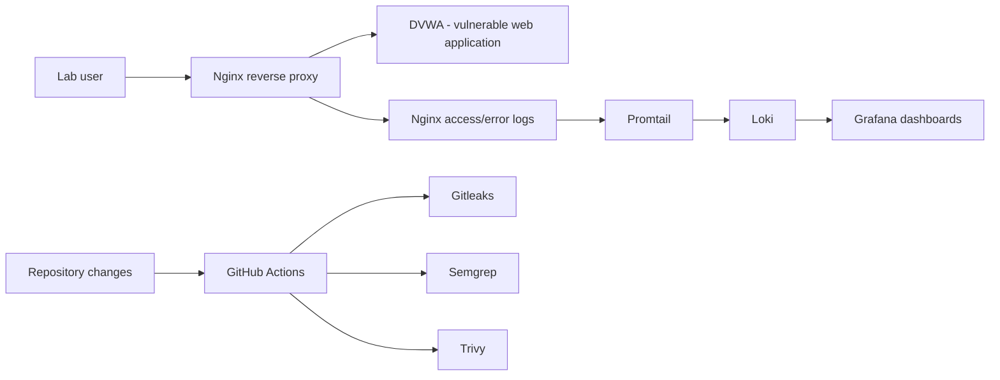

# SecureLab — Web Security Telemetry & DevSecOps Lab

**SecureLab** is a small, container-based teaching environment designed to connect **application traffic**, **reverse-proxy logs**, **centralized observability** and **CI security checks**. It is a portfolio experiment that demonstrates the relationship between preventive application-security controls and security monitoring.

> **Status: experimental / incomplete integration.** The repository contains two separate Compose projects, an Nginx configuration, Loki/Promtail/Grafana definitions and a sample post-incident report. The pipeline and monitoring configuration require validation and corrections before this can be described as an operational, end-to-end SOC deployment.

## Why this project?

Application security has two complementary dimensions:
1. **Build-time:** identify risky code, leaked secrets and vulnerable dependencies or images.
2. **Runtime:** monitor HTTP events, understand suspicious patterns, investigate and document incidents.

SecureLab explores both with a deliberately vulnerable training application and an observable reverse proxy. This is **not designed for exposure on a public server**.

## System architecture



The diagram illustrates the **intended** log path. Note that the two Compose projects use separate Docker networks. In their current form, the application and SOC stacks **do not share an explicit external network**, so additional network configuration is required for dependable end-to-end connectivity. The Nginx proxy configuration also requires review before use.

## Repository structure

```text
.
├── .github/workflows/security-pipeline.yml
├── app/
│   ├── Dockerfile
│   ├── docker-compose.yml      # DVWA + Nginx
│   └── nginx.conf              # Nginx HTTP access/error logs
├── soc/
│   ├── docker-compose.yml      # Loki + Promtail + Grafana
│   ├── loki-config.yml
│   └── promtail-config.yml
├── docs/postmortem-01.md       # Example brute-force incident narrative
└── README.md
```

## Components and responsibilities

| Component | Purpose | Scope |
|---|---|---|
| DVWA | Intentionally vulnerable web application | Authorized offline lab only |
| Nginx | Reverse proxy and structured HTTP event source | Access/error log generation |
| Promtail | Reads Nginx access logs | Log shipping to Loki |
| Loki | Stores searchable application logs | Observability backend |
| Grafana | Query and visualize telemetry | Human investigation |
| GitHub Actions | Runs development-stage security checks | CI workflow |

The current Nginx configuration includes a nonstandard proxy header directive that should be corrected and tested before deployment. The Compose file also publishes DVWA directly on host port 8080, bypassing Nginx. Use local binding or an isolated VM rather than running the current setup on an accessible server.

## How to inspect and validate

**Prerequisites:** Docker and Docker Compose v2 on an isolated machine, basic Nginx knowledge.

```bash
git clone https://github.com/gaddah-yousef/securelab.git
cd securelab

# Static syntax/configuration checks before startup:
docker compose -f app/docker-compose.yml config
docker compose -f soc/docker-compose.yml config

# Review exposed ports, networks and hardcoded credentials:
cat app/nginx.conf
cat soc/promtail-config.yml
```

**Do not run both stacks on an Internet-facing host without remediating the listed issues.** The current Grafana configuration includes an example admin password; replace it with a unique secret before any launch.

### Demonstration outline (after environment corrections)

1. Bring up the web application and reverse proxy on an isolated network.
2. Confirm Nginx forwards requests correctly to the test application.
3. Verify that access logs appear in the mounted log directory.
4. Bring up Promtail, Loki and Grafana with verified shared connectivity.
5. Simulate **authorized** requests and search matching events in Grafana.
6. Record timestamp, source IP (lab network), method, URL, response status and disposition.
7. Document observed evidence, hypotheses and limitations.

Example Loki query (provided only as a starting point):

```logql
{job="nginx"} |= "POST"
```

A burst of requests alone does not establish credential compromise; validate against application behavior and supporting logs.

## CI/CD security controls

The workflow [`security-pipeline.yml`](.github/workflows/security-pipeline.yml) defines:
- **Gitleaks** for detecting committed secrets.
- **Semgrep** for static analysis against OWASP and Docker-oriented rules.
- **Trivy** for HIGH/CRITICAL container vulnerability findings.

**Known integration concern:** the image-scan job builds a Dockerfile under `app/` that copies `nginx.conf`, but the current Dockerfile/working-directory assumptions should be verified on CI. A passing CI configuration is **not established** by this README alone.

## Incident response documentation

The [sample postmortem](docs/postmortem-01.md) describes a simulated login brute-force burst, evidence in logs and proposed mitigations such as rate limiting and MFA. It is an **educational incident narrative**, not independently verified evidence of a live attack.

An analyst should capture:
- attack hypothesis and indicators;
- supporting timestamps/log lines;
- affected service and potential impact;
- containment or tuning actions;
- criteria used to close the investigation.

## Known limitations and security risks

1. Intentionally vulnerable application: should never be exposed to the Internet.
2. Hardcoded demonstration credentials and host-published ports.
3. Separate Compose networks need integration.
4. Nginx config needs syntax and proxy-header validation.
5. No confirmed end-to-end test suite or validated dashboards.
6. Detection rules and SIEM correlation workflows are not included to the same level as the larger [SOC-LAB](https://github.com/gaddah-yousef/SOC-LAB) project.

## Roadmap

- [ ] Repair Nginx configuration and add a container-level config test.
- [ ] Unify networking/volumes in a safe Compose deployment.
- [ ] Bind all local interfaces to `127.0.0.1`; rotate lab credentials.
- [ ] Add reproducible benign HTTP test events and LogQL queries.
- [ ] Create screenshots and evidence from verified test runs.
- [ ] Stabilize CI jobs with pinned maintained actions.
- [ ] Expand postmortems into structured detection and response playbooks.

## Skills and positioning

**Application Security · Docker · Nginx · Loki · Promtail · Grafana · DevSecOps · Incident Investigation · CI security automation.**

**Author:** [Yousef Gaddah](https://github.com/gaddah-yousef) · Authorized training environment only.
