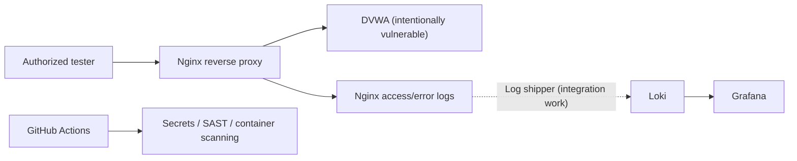

<div align="center">

# 🔐 SecureLab
### Web Security Lab · Log Collection · SOC Observability · DevSecOps


**A learning environment for observing a deliberately vulnerable web application and practising security monitoring.**

[Architecture](#-architecture) · [Repository layout](#-repository-layout) · [Known limitations](#-known-limitations) · [Portfolio](https://github.com/gaddah-yousef/SOC-LAB/blob/main/docs/portfolio/github-projects.md)

</div>

---

## 🎯 Purpose

SecureLab explores how to connect **web application activity** with **centralized log collection** and **DevSecOps checks**. It is intended for isolated, authorized training environments only.

## 🧱 Architecture



The dotted link represents the **intended log-shipping integration**, not a verified working end-to-end pipeline.

## 📁 Repository layout

| Path | Purpose |
| --- | --- |
| [`app/docker-compose.yml`](app/docker-compose.yml) | DVWA and Nginx containers |
| [`app/nginx.conf`](app/nginx.conf) | Reverse-proxy configuration |
| [`soc/docker-compose.yml`](soc/docker-compose.yml) | Loki, Promtail and Grafana definitions |
| [`soc/loki-config.yml`](soc/loki-config.yml) | Loki configuration |
| [`.github/workflows/security-pipeline.yml`](.github/workflows/security-pipeline.yml) | CI security checks |
| [`docs/postmortem-01.md`](docs/postmortem-01.md) | Incident/postmortem exercise |

## 🔎 Review and validation

Read the Compose configurations before starting any services:

```bash
docker compose -f app/docker-compose.yml config
docker compose -f soc/docker-compose.yml config
```

The CI workflow is designed to exercise secret detection, SAST, and container vulnerability scanning. Check the **Actions** tab for actual run outcomes; the existence of a workflow alone does not prove that it passed.

## ⚠️ Known limitations

- **DVWA is intentionally vulnerable.** Do not publish or run this lab on an untrusted or Internet-accessible interface.
- The application Compose file currently publishes ports on all interfaces by default; restrict exposure before deployment.
- The SOC Compose file references `soc/promtail-config.yml`, which is **not present** on the main branch. Full log collection therefore requires configuration work.
- The application and SOC Compose projects require integration checks; no end-to-end runtime success is claimed.
- Some development configurations and sample credentials are for **local lab use only**, never production.

## 🗺️ Suggested next steps

1. Reconcile the Compose files and add the missing log-shipper configuration.
2. Bind dashboards and test endpoints to localhost in the default lab profile.
3. Add a reproducible log-to-alert demonstration with sanitized screenshots.
4. Validate every CI job and document the results.

## 👤 Author

**Yousef Gaddah** · [GitHub](https://github.com/gaddah-yousef) · [Enterprise SOC Lab](https://github.com/gaddah-yousef/SOC-LAB)

> Security testing is permitted **only** on systems you own or are explicitly authorized to assess.
